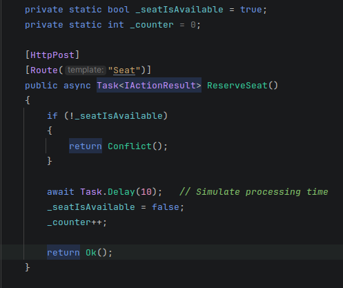
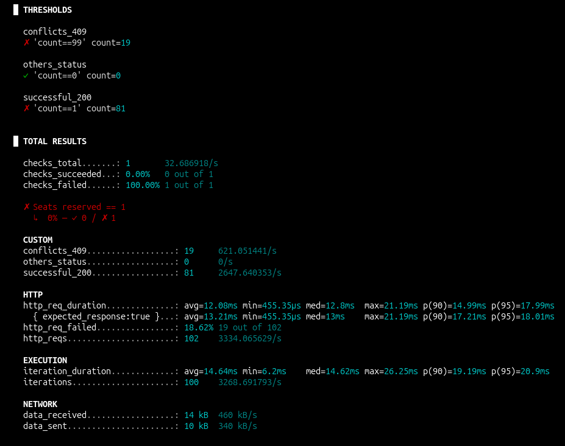
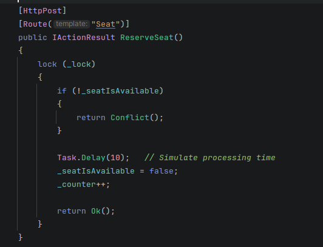
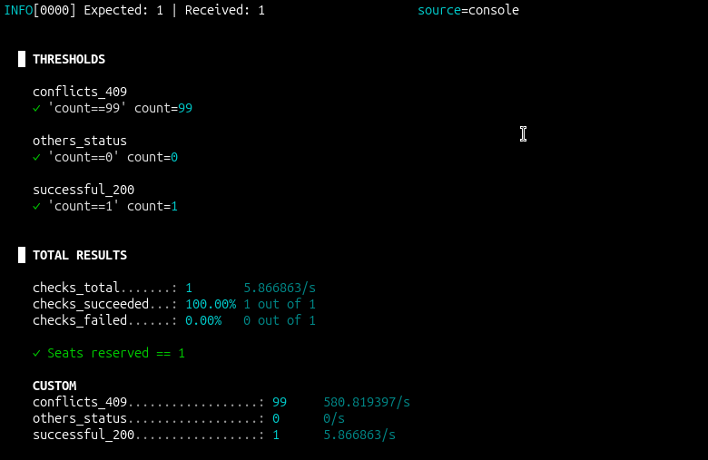

## Race condition

Essa versão acima, quando executada em paralelo, produz race condition.

Porque um executor verifica a condição, executa o código dentro
da condicional e altera o seu valor depois de um tempo.

Outro executor em paralelo, também verifica esse valor e como ainda
não está vendo o valor atualizado, entra na condicional.

Resultado, temos o mesmo assento vendido para mais de uma pessoa.

### Testes k6

Temos 81 requisições retornando 200 OK, ou seja, 81 pessoas
comprando o mesmo assento.

### Correção

Uma das alternativas seria usar lock() para garantir que as requisições 
acessem o recurso uma de cada vez.

## Próxima etapa

O race condition também pode ser a nível de banco, para continuar dando exemplos
vou continuar com o cenário do cinema. 

Na venda online de ingressos, duas pessoas podem ao mesmo tempo tentar comprar ingressos
para o mesmo assento. Temos que prevenir esse comportamento.
